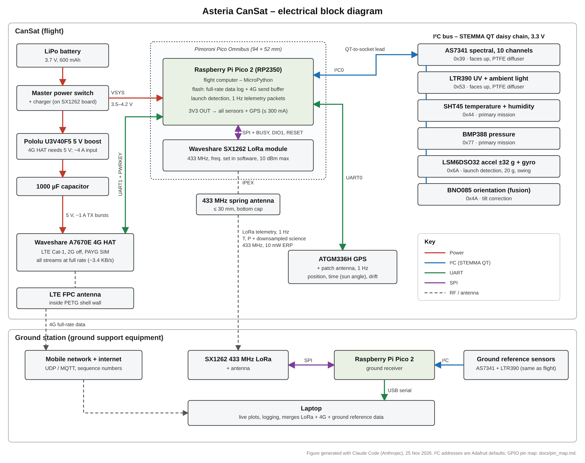

# 4.2 Electrical Design

Draft for the PDR, 25 Nov 2026. Drafted with help from Claude Code (Anthropic), 25 Nov 2026. Reword it in the team's own words, and keep an acknowledgement if the text stays close to this.

## Processor

Our flight computer is a Raspberry Pi Pico 2. We chose it because:

- At £5.80 it is cheap, and it is well documented.
- The 150 MHz dual-core RP2350 has 520 KB of RAM and 4 MB of flash, enough to hold our data log.
- Two I²C, two UART and two SPI buses match what we need: one I²C bus for the sensors, a UART each for the GPS and the 4G module, and SPI for the LoRa radio.
- Raspberry Pi supports MicroPython officially on the Pico 2, and the micropySX126X library drives our SX1262 radio. For the sensors we use existing MicroPython drivers, or port Adafruit's open-source libraries where none exist.
- The Pico and the LoRa module fit together on a Pimoroni Pico Omnibus board (94 × 52 mm), mounted lengthwise in the can.

## Sensors

All the sensors except the GPS (Table X) connect through one chain of STEMMA QT cables on a single I²C bus, so the build needs no soldering. Each has its own I²C address, so they can share the bus. Every plug-in connector will be secured with hot glue or tape for the 20 g launch. Figure X shows how all the components connect.

*Table X: Sensors*

| Component | Measures | Interface | Why chosen |
|---|---|---|---|
| BMP388 | Air pressure (primary) | I²C | ±0.08 hPa relative accuracy (about ±0.66 m of altitude) and fast sampling, giving altitude, descent rate and parachute drag coefficient |
| SHT45 | Air temperature and humidity (primary) | I²C | ±0.1 °C and ±1.0 %RH accuracy; small, so it responds quickly; humidity helps explain haze in the optical data |
| AS7341 | Spectral light intensity (secondary) | I²C | Eight visible bands from 415 to 680 nm plus clear and near-infrared channels, to track the blue/red ratio with height |
| LTR390 | UV and visible light (secondary) | I²C | UV and ambient light on one board; firmware switches between the two modes |
| BNO085 | Absolute orientation | I²C | Sensor fusion on the chip outputs tilt directly, which we need to correct the light readings for parachute swing |
| LSM6DSO32 | Acceleration and rotation | I²C | ±32 g range covers the 20 g launch (the BNO085 only reaches ±8 g); used for launch detection and measuring swing |
| ATGM336H | GPS position and time | UART | Low cost; gives location for recovery, drift, and accurate time for calculating the sun's position |

## Communication and data storage

A Waveshare SX1262 LoRa module on 433 MHz sends telemetry once a second. Its frequency can be changed in software, and we limit transmit power to 10 dBm to stay within UK rules. Each packet carries the compulsory temperature and pressure readings plus a reduced copy of the science data.

While the CanSat is in the air, a Waveshare A7670E 4G module sends all the data at full rate over the mobile network on a pay-as-you-go SIM, so the complete dataset reaches us during the descent. LoRa is the backup if the 4G signal drops. A jumper sets the 4G board's logic level to 3.3 V to match the Pico, and its flexible film antenna is stuck inside the shell wall.

Every measurement is also written to the Pico's own flash. About 2 MB is free alongside MicroPython, roughly 10 minutes at full rate, so full-rate logging starts only when the accelerometer detects launch. The 4G link sends from this log, so anything sent while the signal drops out, for example inside the rocket, is resent once it returns. After recovery we read the log back and compare it with the data received by 4G and LoRa to verify our results.

## Pin allocation

The LoRa board fixes seven of the Pico's pins, and we placed the other buses around them (Table Y). GP16–GP19 stay free as a spare SPI bus.

*Table Y: Pin allocation*

| Function | Pico pins |
|---|---|
| SX1262 LoRa (SPI1, fixed by the board) | SCK GP10, MOSI GP11, MISO GP12, CS GP3, RESET GP15, BUSY GP2, DIO1 GP20 |
| Sensor chain (I²C0) | SDA GP4, SCL GP5 |
| GPS (UART0) | TX GP0, RX GP1, optional pulse-per-second GP21 |
| 4G module (UART1) | TX GP8, RX GP9, power key GP14 |

## Power

The CanSat runs on the single-cell 3.7 V, 600 mAh LiPo supplied with the LoRa module, a voltage that suits the Pico's 1.8–5.5 V input. The LoRa board also has a charger and the master power switch, both reachable from outside the shell. The Pico's 3.3 V output powers the sensors and GPS, which draw about 40 mA together.

The 4G board needs 5 V, supplied by a Pololu U3V40F5 boost converter (15 × 15 mm, 1.5 g, £5.28). The converter takes its input after the master switch, so the switch turns the 4G module off too. It handles about 4 A of input current at 90–95 % efficiency, and a 1000 µF capacitor on its output covers the transmit bursts.

Because the converter raises the voltage, a 1 A burst at 5 V draws about 1.5 A from the battery, close to what the 600 mAh LiPo can supply. We will run a brown-out test with the 4G module transmitting, and switch to a larger LiPo if the Pico resets.

## Current budget

We estimated each component's average current from typical datasheet values (Table Z). Burst loads are averaged over each second; the LoRa radio, for example, transmits for only about 7 % of the time.

*Table Z: Current budget*

| Component | Average current (mA) |
|---|---|
| Pico 2 | 25 |
| SX1262 LoRa (bursts averaged, with headroom) | 15 |
| ATGM336H GPS | 25 |
| BNO085 | 12 |
| BMP388, LSM6DSO32, AS7341, LTR390, SHT45 | 2 |
| A7670E 4G (30 mA at 5 V, mostly asleep on the pad, including boost losses) | 45 |
| **Total** | **≈ 124** |

We count 80 % of the battery as usable (480 mAh), because a LiPo should not be run flat and loses capacity in the cold. At 124 mA that gives about 3.9 hours, against the 3-hour requirement.

The 4G module is the largest uncertainty. If it averaged 100 mA on the 5 V side, the total would rise to about 230 mA and the runtime would fall to about 2.1 hours. The firmware will therefore use the power key to keep the modem asleep on the pad and wake it shortly before launch. Each sensor board's power LED adds roughly 1 mA, and cutting a jumper on each board turns it off.

## Block diagram

*Figure X: Electrical block diagram of the CanSat and ground station. Generated with Claude Code (Anthropic), 25 Nov 2026.*

## Still to confirm

The current figures are estimates. Once the CanSat is assembled, we will measure it with a multimeter in each mode (pad idle, 4G connected, 4G transmitting), update the budget and run the brown-out test. The master switch's current rating also needs checking, because the 4G bursts pass through it. Before the final build, each MicroPython driver will be tested on the bench with the pin map wired up. Mobile coverage will be checked once the launch site is confirmed.
